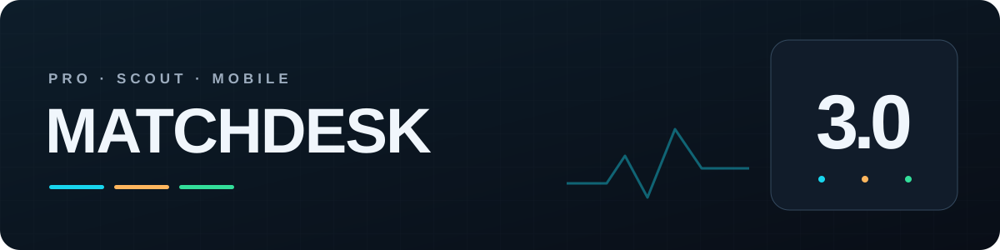
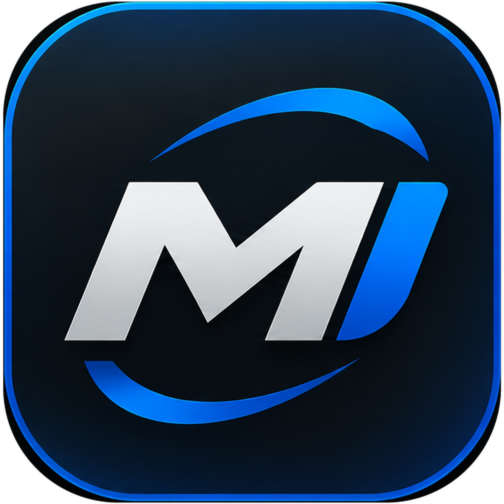
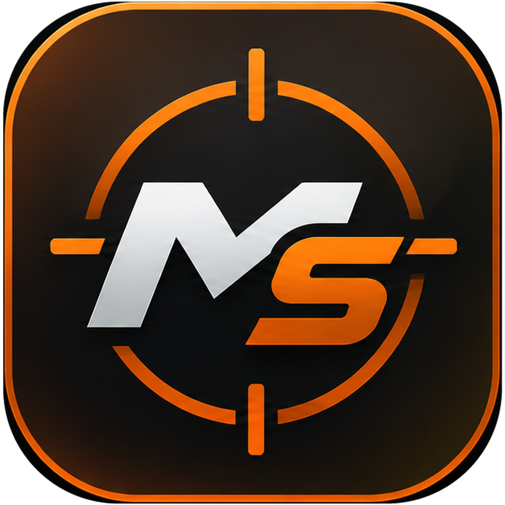
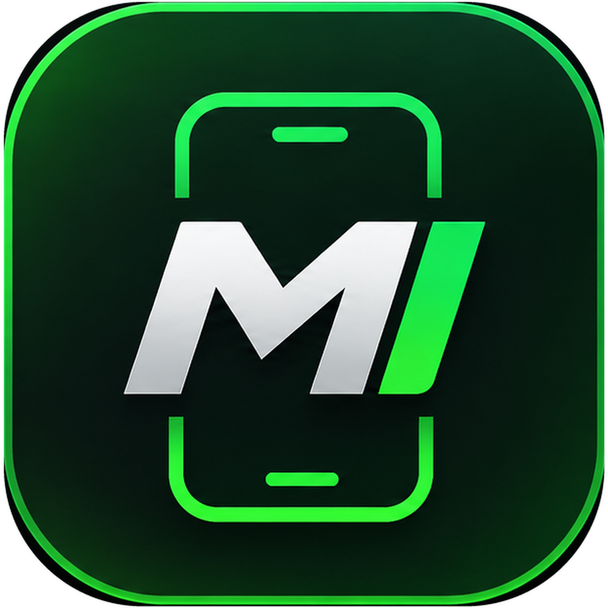

<h1 align="center">MatchDesk 3.0</h1>

A clearer view of every match. More control over your experience.

[Português](README.md) · [English](README.en-US.md) · [Español](README.es-ES.md)

[Download apps](DOWNLOADS.md#english) · [What’s new in 3.0](docs/WHATS_NEW.en-US.md) · [Official website](https://mixdev-br.github.io/MatchDesk/) · [Support](SUPPORT.md#english)

Follow your connection, get to know your squad and tune your eFootball experience. Choose MatchDesk for the way you play: on your PC or with your phone beside your console.

## Choose your MatchDesk

<table>
<tr>
<td width="33%" align="center"><a href="docs/PRO.md#english"> <strong>MatchDesk Pro</strong></a> Connection, squad and controller tools on PC. Windows</td>
<td width="33%" align="center"><a href="docs/SCOUT.md#english"> <strong>MatchDesk Scout</strong></a> Opponent information on your screen. Windows</td>
<td width="33%" align="center"><a href="docs/MOBILE.md#english"> <strong>MatchDesk Mobile</strong></a> Your phone as your match dashboard. Android + OpenWrt</td>
</tr>
</table>

## What’s new in 3.0

### 01 · My Squad

Track goals, assists, appearances and goal contributions per appearance for each card. Search players and switch between your Steam and Xbox PC squads.

### 02 · Controller tester

Check buttons, sticks, triggers, vibration and polling rate in a dedicated screen.

### 03 · USB polling rate

Adjust compatible wired controllers, keep a profile for each controller and check the measured rate. Restore the selected controller’s defaults when needed.

### 04 · PC optimization

Choose ready-made profiles or explained individual settings. Pro skips settings already active or unavailable and provides results and restore options.

### 05 · Stat-based match filter

With Scout integrated into Pro, choose division, ranking, rating and team strength criteria when opponent information is available.

### 06 · Refreshed design

Reorganized screens, a redesigned Scout and customizable overlays. Mobile brings a green identity and ping panel borders that reflect the connection type.

My Squad, controller testing, USB polling rate and PC optimization are Pro features. The stat-based filter uses Scout integrated into Pro. Standalone Scout provides opponent information; Mobile monitors the device connected to your router.

## Get started in a few steps

1. Choose your app and download it from the [official channel](DOWNLOADS.md#english).
2. On Windows, extract the entire ZIP into its own folder and open the app. On Android, install the APK.
3. Activate the matching license and follow the guide: [Pro](docs/PRO.md#english), [Scout](docs/SCOUT.md#english) or [Mobile](docs/MOBILE.md#english).
4. Keep your app updated. In Pro and Scout, choose **Download and install** when an update is offered.

## Before installing

- **Pro and Scout:** 64-bit Windows 10/11. Supports eFootball on Steam and Xbox PC.
- **Pro network capture on PC:** install [Npcap](https://npcap.com/#download) from its official source. Scout does not require Npcap.
- **Mobile:** Android 7 or later and a compatible router running OpenWrt. See the [setup guide in Portuguese](OPENWRT_MOBILE_GUIDE.md).
- Each app requires its corresponding license. Integrated Scout also requires a Scout license.

## Guides and help

[Downloads](DOWNLOADS.md#english) · [Pro](docs/PRO.md#english) · [Scout](docs/SCOUT.md#english) · [Mobile](docs/MOBILE.md#english) · [Support](SUPPORT.md#english) · [Changelog](CHANGELOG.md)

Results depend on your connection, Windows, controller and the information provided by the game. Features do not guarantee lower ping, more FPS or a P2P connection in every match.

---

Official MixDev documentation and distribution repository. Application source code is proprietary. MatchDesk is an independent project with no affiliation with or approval from KONAMI. eFootball and other trademarks belong to their respective owners.
