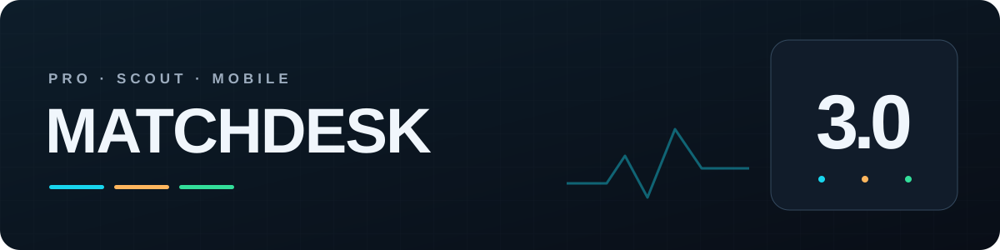
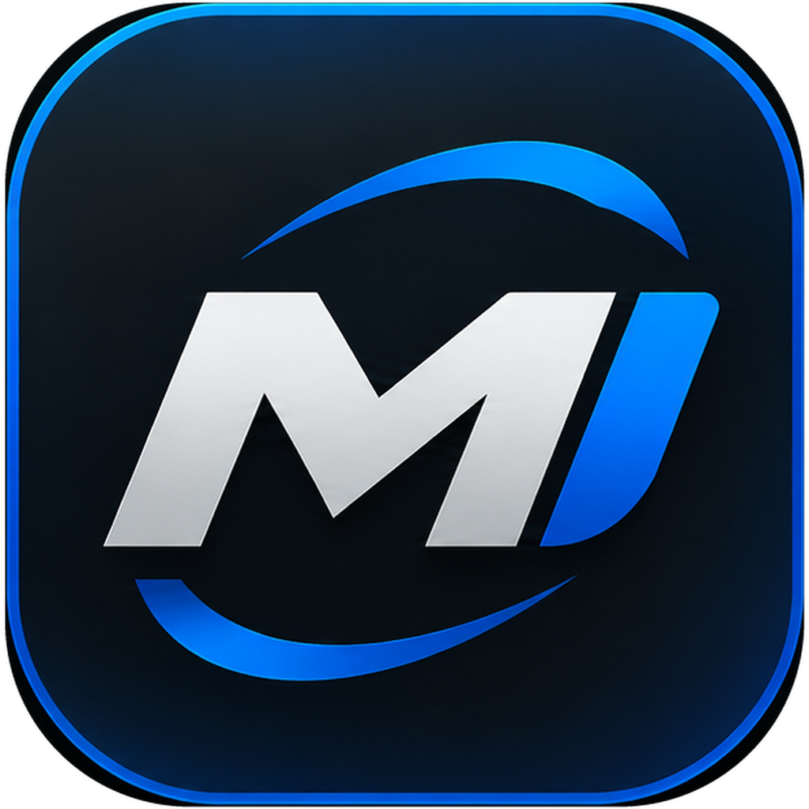
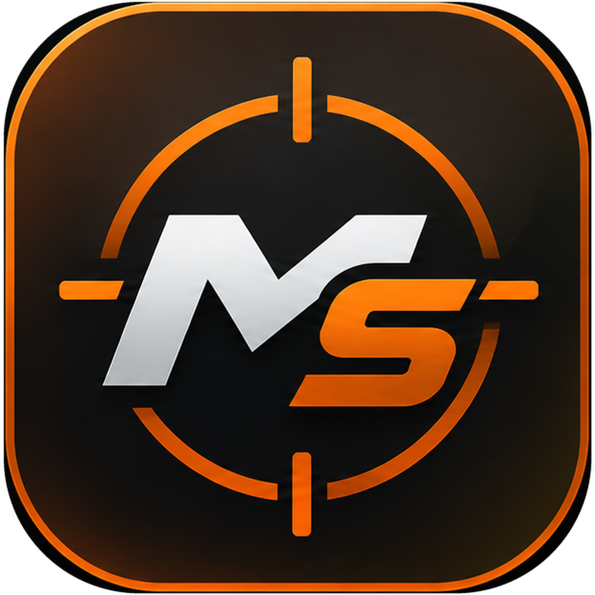
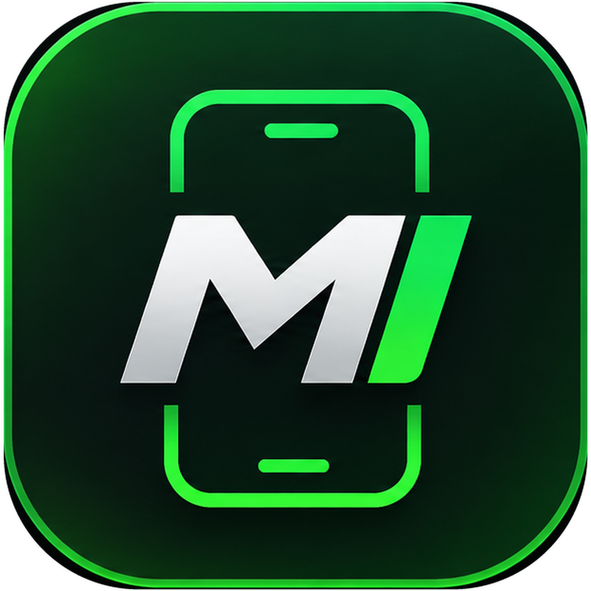

<h1 align="center">MatchDesk 3.0</h1>

Más claridad sobre cada partido. Más control sobre tu experiencia.

[Português](README.md) · [English](README.en-US.md) · [Español](README.es-ES.md)

[Descargar aplicaciones](DOWNLOADS.md#español) · [Novedades 3.0](#novedades-de-la-versión-30) · [Sitio oficial](https://mixdev-br.github.io/MatchDesk/) · [Soporte](SUPPORT.md#español)

Sigue tu conexión, conoce mejor tu plantilla y ajusta tu experiencia en eFootball. Elige MatchDesk para tu forma de jugar: en PC o con el móvil junto a tu consola.

## Elige tu MatchDesk

<table>
<tr>
<td width="33%" align="center"><a href="docs/PRO.md#español"> <strong>MatchDesk Pro</strong></a> Conexión, plantilla y herramientas de mando en PC. Windows</td>
<td width="33%" align="center"><a href="docs/SCOUT.md#español"> <strong>MatchDesk Scout</strong></a> Información del rival en tu pantalla. Windows</td>
<td width="33%" align="center"><a href="docs/MOBILE.md#español"> <strong>MatchDesk Mobile</strong></a> Tu móvil como panel del partido. Android + OpenWrt</td>
</tr>
</table>

## Novedades de la versión 3.0

### 01 · Mi Plantilla (MySquad)

Goles, asistencias, partidos y participaciones de gol por partido de cada carta. Busca jugadores y alterna entre tus plantillas de Steam y Xbox PC.

### 02 · Prueba de mando

Comprueba botones, sticks, gatillos, vibración y frecuencia de respuesta en una pantalla dedicada.

### 03 · Frecuencia USB

Ajusta mandos compatibles conectados por cable, guarda un perfil por mando y comprueba la frecuencia medida. Restaura el mando seleccionado cuando lo necesites.

### 04 · Optimización del PC

Elige perfiles o ajustes individuales explicados. Pro omite los ajustes ya activos o no disponibles y ofrece un informe y opciones de restauración.

### 05 · Filtro por estadísticas

Con Scout integrado en Pro, elige criterios de división, ranking, rating y fuerza colectiva cuando la información del rival esté disponible.

### 06 · Diseño renovado

Pantallas reorganizadas, Scout rediseñado y overlays personalizables. Mobile incorpora una identidad verde y bordes del panel de ping según el tipo de conexión.

Mi Plantilla, prueba de mando, frecuencia USB y optimización del PC son funciones de Pro. El filtro por estadísticas usa Scout integrado en Pro. Scout independiente muestra información del rival; Mobile monitoriza el dispositivo conectado al router.

## Empieza en pocos pasos

1. Elige tu aplicación y descárgala desde el [canal oficial](DOWNLOADS.md#español).
2. En Windows, extrae todo el ZIP en una carpeta propia y abre la aplicación. En Android, instala el APK.
3. Activa la licencia correspondiente y consulta la guía: [Pro](docs/PRO.md#español), [Scout](docs/SCOUT.md#español) o [Mobile](docs/MOBILE.md#español).
4. Mantén la aplicación actualizada. En Pro y Scout, elige **Descargar e instalar** cuando se ofrezca una actualización.

## Antes de instalar

- **Pro y Scout:** Windows 10/11 de 64 bits. Compatible con eFootball para Steam y Xbox PC.
- **Captura de red de Pro en PC:** instala [Npcap](https://npcap.com/#download) desde su fuente oficial. Scout no necesita Npcap.
- **Mobile:** Android 7 o superior y un router compatible con OpenWrt. Consulta la [guía de configuración en portugués](OPENWRT_MOBILE_GUIDE.md).
- Cada aplicación requiere su licencia correspondiente. Scout integrado también necesita una licencia Scout.

## Guías y ayuda

[Descargas](DOWNLOADS.md#español) · [Pro](docs/PRO.md#español) · [Scout](docs/SCOUT.md#español) · [Mobile](docs/MOBILE.md#español) · [Soporte](SUPPORT.md#español) · [Historial](CHANGELOG.md)

Los resultados dependen de la conexión, Windows, el mando y la información facilitada por el juego. Las funciones no garantizan menos ping, más FPS ni una conexión P2P en todos los partidos.

---

Repositorio oficial de documentación y distribución de MixDev. El código de las aplicaciones es propietario. MatchDesk es un proyecto independiente, sin afiliación ni aprobación de KONAMI. eFootball y las demás marcas pertenecen a sus respectivos titulares.
