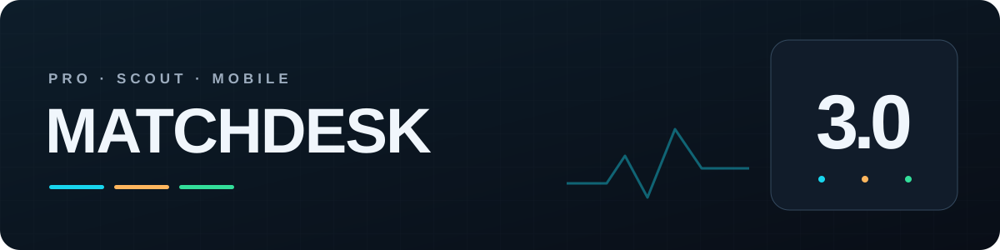
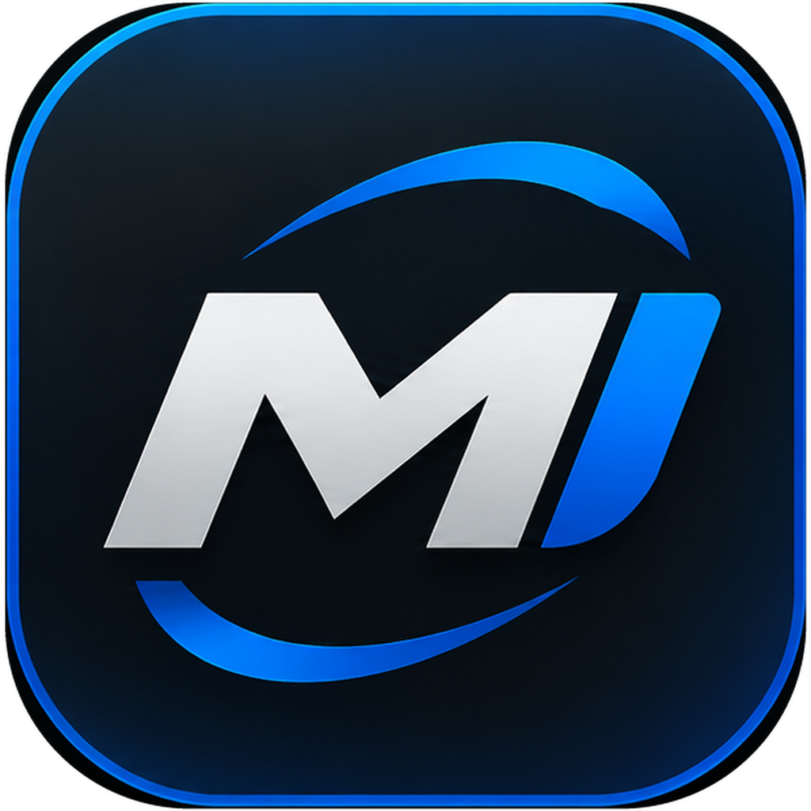
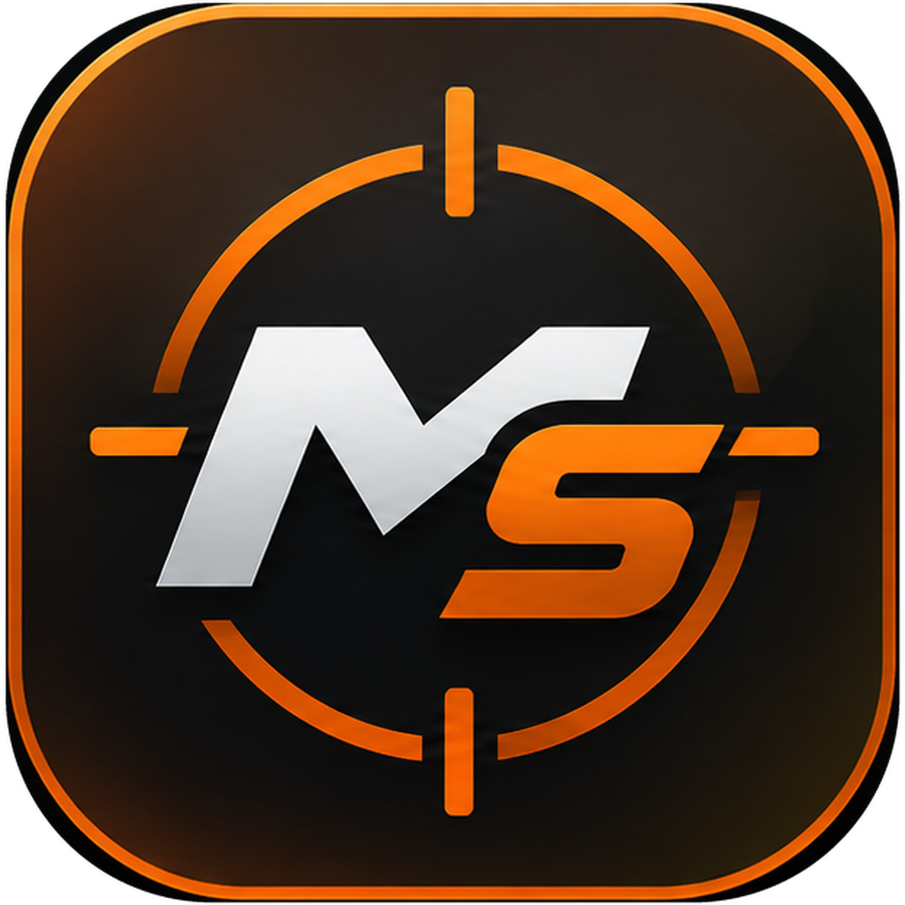
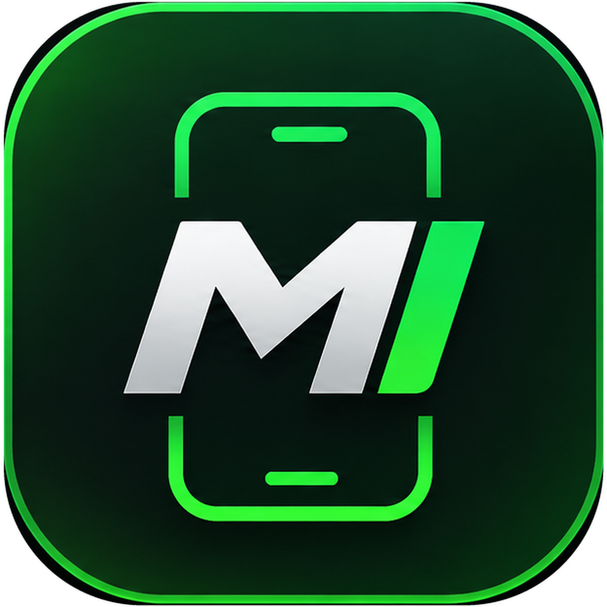

<h1 align="center">MatchDesk 3.0</h1>

Mais clareza sobre a partida. Mais controle sobre sua experiência.

[Português](README.md) · [English](README.en-US.md) · [Español](README.es-ES.md)

[Baixar aplicativos](DOWNLOADS.md#português) · [Novidades da versão 3.0](docs/WHATS_NEW.pt-BR.md) · [Site oficial](https://mixdev-br.github.io/MatchDesk/) · [Suporte](SUPPORT.md#português)

Acompanhe sua conexão, conheça melhor seu elenco e ajuste sua experiência no eFootball. Escolha o MatchDesk para o seu jeito de jogar: no PC ou com o celular ao lado do console.

## Escolha seu MatchDesk

<table>
<tr>
<td width="33%" align="center"><a href="docs/PRO.md#português"> <strong>MatchDesk Pro</strong></a> Conexão, elenco e controle no PC. Windows</td>
<td width="33%" align="center"><a href="docs/SCOUT.md#português"> <strong>MatchDesk Scout</strong></a> Informações do adversário na sua tela. Windows</td>
<td width="33%" align="center"><a href="docs/MOBILE.md#português"> <strong>MatchDesk Mobile</strong></a> Seu celular como painel da partida. Android + OpenWrt</td>
</tr>
</table>

## O que muda na versão 3.0

### 01 · Meu Elenco (MySquad)

Gols, assistências, partidas e participação em gols por partida de cada carta. Pesquise jogadores e alterne entre seus elencos Steam e Xbox PC.

### 02 · Teste de controle

Confira botões, analógicos, gatilhos, vibração e frequência de resposta em uma tela dedicada.

### 03 · Frequência USB

Ajuste controles compatíveis conectados por cabo, mantenha um perfil por controle e confira a taxa medida. A restauração é feita no controle selecionado.

### 04 · Otimização do PC

Escolha perfis prontos ou ajustes individuais explicados. O Pro pula o que já está ativo ou indisponível e mostra o relatório, com opção de restauração.

### 05 · Filtro por estatísticas

No Pro com Scout, defina critérios de divisão, ranking, rating e força coletiva para filtrar adversários quando as informações estiverem disponíveis.

### 06 · Visual renovado

Telas reorganizadas, Scout redesenhado e overlays personalizáveis. No Mobile, a identidade verde acompanha bordas de ping com cores por tipo de conexão.

Meu Elenco, teste de controle, frequência USB e otimização do PC fazem parte do Pro. O filtro por estatísticas usa o Scout integrado ao Pro. O Scout independente acompanha informações do adversário; o Mobile monitora o aparelho conectado ao roteador.

## Comece em poucos passos

1. Escolha o aplicativo e baixe pelo [canal oficial](DOWNLOADS.md#português).
2. No Windows, extraia o ZIP inteiro em uma pasta própria e abra o aplicativo. No Android, instale o APK.
3. Ative a licença correspondente e siga o guia: [Pro](docs/PRO.md#português), [Scout](docs/SCOUT.md#português) ou [Mobile](docs/MOBILE.md#português).
4. Mantenha o app atualizado. No Pro e no Scout, use **Baixar e instalar** quando uma atualização for oferecida.

## Antes de instalar

- **Pro e Scout:** Windows 10/11 de 64 bits. Suporte a eFootball para Steam e Xbox PC.
- **Captura de rede do Pro no PC:** instale o [Npcap](https://npcap.com/#download) pela fonte oficial. O Scout não precisa de Npcap.
- **Mobile:** Android 7 ou superior e roteador executando OpenWrt compatível. Veja o [guia de configuração](OPENWRT_MOBILE_GUIDE.md).
- Cada aplicativo exige sua licença correspondente. O Scout integrado também requer licença Scout.

## Guias e ajuda

[Downloads](DOWNLOADS.md#português) · [Pro](docs/PRO.md#português) · [Scout](docs/SCOUT.md#português) · [Mobile](docs/MOBILE.md#português) · [Suporte](SUPPORT.md#português) · [Histórico](CHANGELOG.md)

Os resultados dependem da conexão, do Windows, do controle e das informações disponibilizadas pelo jogo. Os recursos não garantem menor ping, mais FPS ou uma conexão P2P em todas as partidas.

---

Repositório oficial de documentação e distribuição da MixDev. O código dos aplicativos é proprietário. MatchDesk é um projeto independente, sem vínculo ou aprovação da KONAMI. eFootball e as demais marcas pertencem aos seus respectivos titulares.
